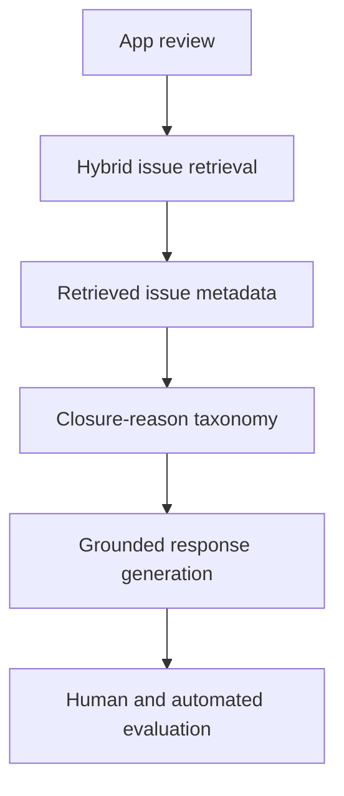

# Closure-Aware Review-to-Issue Intelligence

Research code and reproducible evidence for linking app reviews to software issues and generating responses that distinguish **resolved**, **rejected**, **abandoned**, and **redirected** closures.

[](https://github.com/ogtayhasanov/closure-aware-review-to-issue/actions/workflows/reproduce.yml)

This work studies a traceability failure that matters for AI-assisted software maintenance: a closed issue is often treated as a fixed issue, even when it was rejected, abandoned for missing information, or redirected elsewhere. The pipeline retrieves candidate issues, interprets closure evidence, and conditions a grounded response on the inferred outcome.



## Main findings

| Evaluation | Result |
| --- | ---: |
| Closure taxonomy validation | 117/120 correct; macro-F1 0.9747; Cohen's kappa 0.9667 |
| Blinded human status evaluation | Closure-aware 34/36 vs binary-state 1/36 |
| Paired significance | Exact two-sided McNemar p = 2.33e-10 |
| NEEDS_INFO action realization | Closure-aware 16/16 vs raw-metadata 4/16 |
| REDIRECTED action realization | Closure-aware 7/7 vs raw-metadata 0/7 |

The broader study covers 117,695 closed issues from nine projects across GitHub, Bugzilla, and Trac. At least 28.6% were explicit rejections, abandonments, or redirections rather than completed resolutions. A second central result is negative: synthetic-validation gains for a fine-tuned retriever did not reliably transfer to real human-labeled retrieval.

## Reproduce the public evidence

The reproducer uses only the Python standard library and normally finishes in under one minute.

```bash
python scripts/validate_public_snapshot.py
python scripts/reproduce_all.py
python -m unittest discover -s tests -v
```

The first command checks row counts, secrets, prohibited raw-text columns, binary files, and unexpectedly long data cells. The second regenerates the metrics under `results/generated/` from text-free, case-level evidence.

## Repository scope

This is a public research snapshot, not the complete internal evidence archive. It includes:

- the closure taxonomy and statistical implementation;
- frozen protocols and the experiment contract;
- opaque case identifiers, categorical labels, judgments, and scores;
- deterministic reproduction scripts, tests, and continuous integration.

It intentionally excludes app-review text, issue titles and bodies, comments, generated responses, and annotation workbooks while redistribution terms are being reviewed. See [DATA_AVAILABILITY.md](DATA_AVAILABILITY.md) for the exact boundary.

## Layout

- `src/closure_artifact/`: dependency-free metrics, taxonomy, and analyses.
- `data/derived/`: text-free case-level evidence and study-scale aggregates.
- `protocols/`: frozen evaluation and statistical specifications.
- `scripts/`: validation and one-command reproduction.
- `tests/`: regression tests for the reported headline values.
- `docs/`: methodology and evidence-status notes.

## Research status

This repository accompanies ongoing MSc research and a manuscript in preparation:

> Ogtay Hasanov, Saad Ezzini, Hamzah Luqman and Xunzhu Tang. *From User Reviews to Grounded Responses: Closure-Reason-Aware Response Generation over Retrieved Software Issues.* 2026.

For citation metadata, see [CITATION.cff](CITATION.cff).
