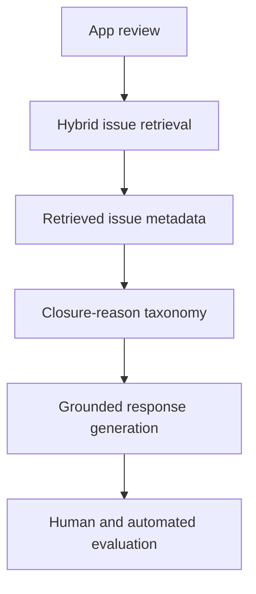

# Closure-Aware Review-to-Issue Intelligence

Research code and reproducible evidence for linking app reviews to software issues and generating responses that distinguish **resolved**, **rejected**, **abandoned**, and **redirected** closures.

This work studies a traceability failure that matters for AI-assisted software maintenance: a closed issue is often treated as a fixed issue, even when it was rejected, abandoned for missing information, or redirected elsewhere. The pipeline retrieves candidate issues, interprets closure evidence, and conditions a grounded response on the inferred outcome.



## Main findings

| Evaluation | Result |
| --- | ---: |
| Closure taxonomy validation | 117/120 correct; macro-F1 0.9747; Cohen's kappa 0.9667 |
| Blinded human status evaluation | Closure-aware 34/36 vs binary-state 1/36 |
| RAW METADATA human audit (re-labeled 8 Nov 2026; original labels not retained) | 34/36 correct |
| Paired significance | Exact two-sided McNemar p = 2.33e-10 |
| Original post-hoc action audit | NEEDS_INFO 16/16 vs 4/16 and REDIRECTED 7/7 vs 0/7, closure-aware vs raw |
| Shared-prompt outcome audit, GPT-4o-mini | Raw 33/35, closure-aware 30/35, binary 20/35 |
| Bot-closure probe, GPT-4o-mini | Judge-coded false declines 50/50 raw, 49/50 V2, 50/50 raw + meaning, 12/50 taxonomy only |
| Bot-closure probe, Gemma | Judge-coded false declines 23/50 raw, 0/50 raw + meaning or taxonomy only |
| Shared-prompt switch, GPT-4o-mini | 12/50 bot-probe declines and 29/35 specific fair-audit outcomes |
| External retrieval and abstention | RRF MRR 0.289 vs BGE-ZS 0.205. At 50% coverage, 12/14 strict successes are retained |

The broader study covers 117,695 closed issues from nine projects across GitHub, Bugzilla, and Trac. At least 28.6% were explicit rejections, abandonments, or redirections rather than completed resolutions. A second central result is negative: synthetic-validation gains for a fine-tuned retriever did not reliably transfer to real human-labeled retrieval.

## Reproduce the public evidence

Use Python 3.10 or later. The verifier uses the standard library, runs offline, and normally finishes in under one minute.

```bash
python scripts/verify_submission.py
```

The verifier checks the text-free tables and the working-artifact checksums, regenerates the archived metrics in a temporary directory, compares the results, and runs the tests. [Reviewer guide](docs/REVIEWER_GUIDE.md)

The follow-up ledger contains 1,780 responses represented by their decisions, covering the shared-prompt replication, all six bot-probe arms, taxonomy only, and raw + meaning for both generators. The switch is recomputed by selecting saved arm decisions per case. [Follow-up methods and results](docs/FOLLOW_UP.md) gives the arm definitions, score sources, and caveats. [Evidence coverage](docs/RESULTS.md) distinguishes reproduced and manuscript-reported results, including the DeepMatcher appendix.

## Repository scope

The text-free snapshot in `data/derived/` contains the frozen scores and decisions used by the reproduction scripts. The working artifacts include original generation and judge logs, recovered execution scripts, the completed Table 8 workbook, the BGE-FT full ranks, and the Appendix C DeepMatcher archives. [Working artifacts inventory](working_artifacts/README.md) · [Data availability](DATA_AVAILABILITY.md)

## Layout

- `src/closure_artifact/`: dependency-free metrics, taxonomy, and analyses.
- `data/derived/`: text-free case-level evidence and study-scale aggregates.
- `protocols/`: frozen evaluation and statistical specifications.
- `scripts/`: validation and one-command reproduction.
- `tests/`: regression tests for the reported headline values.
- `docs/`: methodology and evidence-status notes.
- `working_artifacts/`: original run files, case-level crosswalks, and the source checksum inventory.

## Research status

This repository accompanies ongoing MSc research and a manuscript in preparation:

> Ogtay Hasanov, Saad Ezzini, Hamzah Luqman, and Xunzhu Tang. *From User Reviews to Grounded Responses: Closure-Reason-Aware Response Generation over Retrieved Software Issues.* 2026.

For citation metadata, see [CITATION.cff](CITATION.cff).
